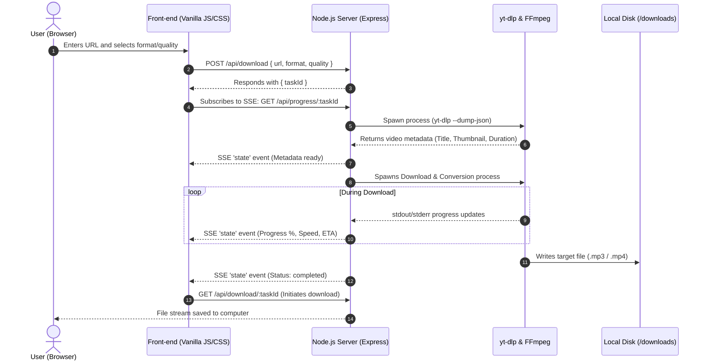

<div align="center">

# ⚡ OmniFetch v2.0
### Modern Media Extraction and Conversion Utility for MP3 & MP4

<p align="center">
  <a href="README.md">🇧🇷 Português</a> •
  <a href="README.en.md">🇺🇸 English</a> •
  <a href="README.es.md">🇪🇸 Español</a>
</p>

[](https://nodejs.org/)
[](https://expressjs.com/)
[](https://github.com/yt-dlp/yt-dlp)
[](https://ffmpeg.org/)
[](LICENSE)

<br/>


<p align="center">
  <b>Download and convert videos and audios from YouTube, TikTok (watermark-free), and Instagram at maximum speed with an ultra-fluid interface and real-time metrics.</b>
</p>

</div>

---

## 📑 Table of Contents

- [Overview](#-overview)
- [Key Features](#-key-features)
- [Supported Platforms](#-supported-platforms)
- [Formats & Quality Profiles](#-formats--quality-profiles)
- [Architecture & Workflow](#-architecture--workflow)
- [Tech Stack](#-tech-stack)
- [Prerequisites](#-prerequisites)
- [Installation & Quick Start](#-installation--quick-start)
- [Local API Reference](#-local-api-reference)
- [Design System & Interface](#-design-system--interface)
- [Troubleshooting & FAQ](#-troubleshooting--faq)
- [Legal Disclaimer](#-legal-disclaimer)
- [License](#-license)

---

## 🌟 Overview

**OmniFetch** is a full-featured local utility designed for individuals who need to extract, convert, and download media from the web without intrusive ads, artificial rate limits, or privacy concerns typical of third-party websites.

Running locally on your computer via **Node.js**, OmniFetch leverages high-performance native binaries from **yt-dlp** and **FFmpeg**. Every stage of the conversion is broadcasted live using **Server-Sent Events (SSE)** into a clean, modern *Dark Obsidian* web interface featuring cosmic *Breathing Star Flares* and subtle glassmorphic styling.

---

## 🚀 Key Features

- ⚡ **Local Hardware Processing:** Direct execution without cloud queues, subscription paywalls, or third-party storage.
- 🎵 **Smart Audio Extraction (MP3):** Pure, clean sound extraction with custom bitrates up to 320 kbps.
- 🎬 **Video Downloads (MP4):** Crystal-clear video support up to 1080p Full HD with automated audio/video stream muxing via FFmpeg.
- 💧 **Watermark-Free TikTok:** Automatically identifies and downloads clean, non-watermarked streams whenever available.
- 📡 **Real-Time SSE Metrics:** Live tracking of download speed (MB/s), estimated completion time (ETA), exact percentage, and file size.
- 📋 **1-Click Convenience:** Built-in *Clipboard API* integration for pasting links instantly with automated platform detection.
- 🕒 **Persistent Local History:** Recent files remain recorded in your browser's `localStorage` for immediate re-downloads.
- 🧹 **Automated Disk Cleanup:** Self-maintaining server deletes temporary files and downloads older than 1 hour every 15 minutes.
- 🔄 **Self-Healing Binary Setup:** Automatically downloads the `yt-dlp` executable if missing and checks for background updates on startup.

---

## 🌐 Supported Platforms

| Platform | Support Status | Notes |
| :--- | :---: | :--- |
| **YouTube** | ✅ Full Support | Standard videos, Shorts, and audio extraction with original cover art & metadata. |
| **TikTok** | ✅ Full Support | High-definition media extracted **without watermarks** (*watermark-free streams*). |
| **Instagram** | ✅ Full Support | Reels, public posts, and video carousels. *(Private profiles require login and are not supported).* |
| **General Web** | ✅ Broad Support | Hundreds of websites natively supported by the yt-dlp core engine. |

---

## 🎚️ Formats & Quality Profiles

### 🎵 Audio (MP3)
| Preset | Bitrate | Best Used For |
| :--- | :---: | :--- |
| **High Quality** | **320 kbps** | High-fidelity music listening and archival. |
| **Medium Quality** | **192 kbps** | Podcasts, interviews, and balanced storage efficiency. |
| **Low Quality** | **128 kbps** | Long voice recordings, speech, and minimal file size. |

### 🎬 Video (MP4)
| Preset | Target Resolution | Processing Details |
| :--- | :---: | :--- |
| **High Quality** | **1080p (Full HD)** | Top-tier video stream merged with highest quality audio track. |
| **Medium Quality** | **720p (HD)** | Crisp quality with faster download speeds and compact size. |
| **Low Quality** | **480p (SD)** | Ultra-fast download speeds, lightweight video files. |

---

## 🏗️ Architecture & Workflow

OmniFetch uses a decoupled, event-driven architecture designed around single-direction event streams:



---

## 💻 Tech Stack

### Back-end
- **[Node.js](https://nodejs.org/):** Asynchronous JavaScript runtime environment.
- **[Express 5](https://expressjs.com/):** High-performance routing, static asset serving, and SSE streaming.
- **[Server-Sent Events (SSE)](https://developer.mozilla.org/en-US/docs/Web/API/Server-sent_events):** Unidirectional real-time metrics stream with zero WebSocket overhead.
- **[yt-dlp](https://github.com/yt-dlp/yt-dlp):** State-of-the-art multimedia extractor CLI.
- **[@ffmpeg-installer/ffmpeg](https://www.npmjs.com/package/@ffmpeg-installer/ffmpeg):** Bundled FFmpeg static binaries for format remuxing and audio encoding.

### Front-end
- **Vanilla Web (HTML5, Modern CSS, ES6+ JS):** Zero bloated JavaScript frameworks (no React, Vue, or Angular) for instant cold boots and near-zero memory footprint.
- **Dark Obsidian Design System:** Deep purple and obsidian theme enhanced by glowing ambient *Breathing Star Flares*.
- **[Lucide Icons](https://lucide.dev/):** Lightweight, crisp SVG icons.
- **Typography:** *Inter* for clean navigational readability and *JetBrains Mono* for technical telemetry.

---

## 📋 Prerequisites

To run OmniFetch on your machine, you only need:
- **[Node.js](https://nodejs.org/)** version `18.0.0` or higher.
- **NPM** (bundled with Node.js).
- An active internet connection.

> [!NOTE]
> You **do not** need to manually install FFmpeg or yt-dlp on your operating system. The FFmpeg binary is supplied through npm dependencies, and yt-dlp is automatically downloaded and kept up-to-date by the server upon initialization.

---

## 🛠️ Installation & Quick Start

### 1. Clone or Download Repository
```bash
git clone https://github.com/Nann-spec/omni-fetch.git
cd omni-fetch
```

### 2. Install Dependencies
```bash
npm install
```

### 3. Launch the Server
```bash
npm start
```
*or development mode:*
```bash
npm run dev
```

> [!TIP]
> Once started on port `3000`, the server will **automatically launch your default web browser** to `http://localhost:3000`.

---

## 🔌 Local API Reference

If you want to integrate OmniFetch into shell scripts or external tools, the following REST endpoints are available:

### 1. Request Download Task
- **Method:** `POST`
- **Route:** `/api/download`
- **Headers:** `Content-Type: application/json`
- **Payload:**
  ```json
  {
    "url": "https://www.youtube.com/watch?v=dQw4w9WgXcQ",
    "format": "mp3",     // "mp3" or "mp4"
    "quality": "high"    // "high", "medium", or "low"
  }
  ```
- **Response (200 OK):**
  ```json
  {
    "taskId": "3fa85f64-5717-4562-b3fc-2c963f66afa6"
  }
  ```

### 2. Stream Live Progress (SSE)
- **Method:** `GET`
- **Route:** `/api/progress/:taskId`
- **Content-Type:** `text/event-stream`
- **Broadcast Events:** `event: state`
  ```json
  {
    "status": "downloading",
    "progress": 64.5,
    "speed": "8.42MiB/s",
    "eta": "00:12",
    "title": "Video Title",
    "thumbnail": "https://...",
    "duration": "3:33",
    "platform": "Youtube",
    "fileName": "Video Title.mp3",
    "error": ""
  }
  ```

### 3. Retrieve Converted File
- **Method:** `GET`
- **Routes:**
  - `/api/download/:taskId`
  - `/api/files/:taskId`
- **Response:** Raw binary file stream with `Content-Disposition: attachment`.

### 4. Trigger Binary Update
- **Method:** `POST`
- **Route:** `/api/update`
- **Response:**
  ```json
  {
    "success": true,
    "message": "yt-dlp verificado/atualizado com sucesso!"
  }
  ```

---

## 🎨 Design System & Interface

For full details on the color palette, CSS tokens, glassmorphism rules, and component specifications (Confirm Modals, Toasts, Progress Cards), please consult:
👉 **[DESIGN.md](file:///C:/Users/nanan/Documents/GeminiCLI/youtube-to-mp3-or-mp4/DESIGN.md)**

---

## ❓ Troubleshooting & FAQ

### Why did an Instagram download fail?
Instagram restricts private profiles and checkpoint-protected accounts. OmniFetch accesses public media without authentication. If content requires logging into Instagram, an explanatory error message is returned.

### Why is a download slowing down or stalling?
Video platforms frequently update throttling algorithms. If downloads degrade, restart the server or call `/api/update` to retrieve the latest version of yt-dlp.

### Where are temporary files saved?
Files are stored locally inside `downloads/<taskId>/`. An automatic daemon checks every 15 minutes and permanently deletes files older than 1 hour.

---

## ⚖️ Legal Disclaimer

> [!IMPORTANT]
> **Educational & Personal Use Only:**
> This software has been created solely for educational, research, and strictly personal purposes.
> 
> * **Intellectual Property & Terms of Service:** The end user bears full and sole responsibility for using this tool in accordance with local copyright legislation and the Terms of Service of each accessed platform (YouTube, TikTok, Instagram, etc.). **Do not use this software to download, store, or distribute copyrighted materials without explicit permission from the rights holder.**
> * **Trademark Attribution:** All third-party registered trademarks, product names, and company logos referenced herein belong to their respective owners and are mentioned purely for descriptive and interoperability purposes.
> * **Limitation of Liability:** The developers and maintainers of this project do not endorse piracy and accept no legal liability for improper, unauthorized, or unlawful usage by third parties.

---

## 📄 License

Distributed under the **ISC** License. Refer to [package.json](file:///C:/Users/nanan/Documents/GeminiCLI/youtube-to-mp3-or-mp4/package.json) for details.

<div align="center">
  <sub>Engineered for local autonomy, speed, and privacy.</sub>
</div>
