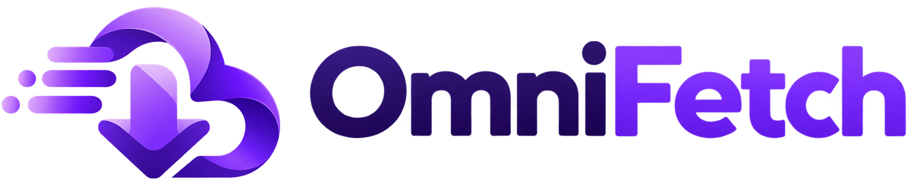
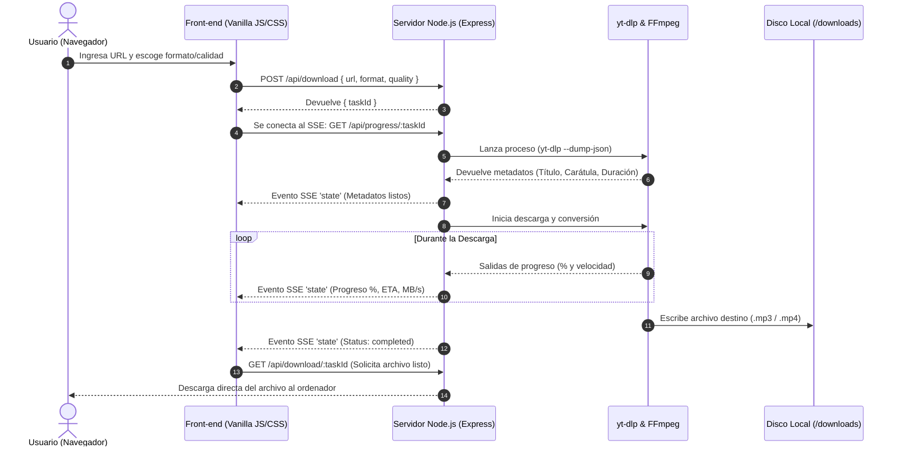

<div align="center">

# ⚡ OmniFetch v2.0
### Utilidad Moderna de Extracción y Conversión de Medios a MP3 y MP4

<p align="center">
  <a href="README.md">🇧🇷 Português</a> •
  <a href="README.en.md">🇺🇸 English</a> •
  <a href="README.es.md">🇪🇸 Español</a>
</p>

[](https://nodejs.org/)
[](https://expressjs.com/)
[](https://github.com/yt-dlp/yt-dlp)
[](https://ffmpeg.org/)
[](LICENSE)

<br/>



<p align="center">
  <b>Descarga y convierte videos y audios de YouTube, TikTok (sin marca de agua) e Instagram a máxima velocidad, con una interfaz ultrafluida y métricas en tiempo real.</b>
</p>

</div>

---

## 📑 Tabla de Contenidos

- [Descripción General](#-descripción-general)
- [Características Principales](#-características-principales)
- [Plataformas Compatibles](#-plataformas-compatibles)
- [Tabla de Formatos y Calidad](#-tabla-de-formatos-y-calidad)
- [Arquitectura y Flujo de Funcionamiento](#-arquitectura-y-flujo-de-funcionamiento)
- [Tecnologías Utilizadas (Tech Stack)](#-tecnologías-utilizadas-tech-stack)
- [Requisitos Previos](#-requisitos-previos)
- [Instalación y Uso](#-instalación-y-uso)
- [Referencia de la API Local](#-referencia-de-la-api-local)
- [Sistema de Diseño e Interfaz](#-sistema-de-diseño-e-interfaz)
- [Preguntas Frecuentes (FAQ)](#-preguntas-frecuentes-faq)
- [Aviso Legal (Descargo de Responsabilidad)](#-aviso-legal-descargo-de-responsabilidad)
- [Licencia](#-licencia)

---

## 🌟 Descripción General

**OmniFetch** es una aplicación local integral pensada para quienes necesitan extraer, convertir y descargar contenido multimedia de la web sin sufrir anuncios molestos, límites arbitrarios de velocidad o riesgos de privacidad habituales en sitios web de terceros.

Al ejecutarse localmente en tu ordenador mediante **Node.js**, OmniFetch aprovecha la potencia de los binarios de **yt-dlp** y **FFmpeg**. Cada fase de la descarga se transmite en vivo mediante **Server-Sent Events (SSE)** hacia una interfaz oscura, moderna y responsiva basada en estética *Dark Obsidian* con efectos *Glassmorphism* y destellos cósmicos ambientales (*Breathing Star Flares*).

---

## 🚀 Características Principales

- ⚡ **Rendimiento Nativo Local:** Procesamiento directo en el hardware de tu equipo, sin intermediarios remotos ni colas de espera.
- 🎵 **Extracción Inteligente a MP3:** Extracción nítida de pistas de audio con tasas de bits seleccionables (hasta 320 kbps).
- 🎬 **Descarga de Video en MP4:** Compatibilidad con resoluciones de hasta 1080p Full HD con multiplexación automática de audio y video vía FFmpeg.
- 💧 **TikTok Sin Marca de Agua:** Detección y descarga preferencial de flujos limpios sin marcas de agua.
- 📡 **Métricas en Tiempo Real vía SSE:** Visualiza la velocidad de transferencia (MB/s), tiempo estimado (ETA), porcentaje exacto y peso del archivo.
- 📋 **Agilidad en 1 Clic:** Botón integrado con la *Clipboard API* para pegar enlaces al instante y detección automática de la plataforma.
- 🕒 **Historial Local de Descargas:** Los archivos recientes se guardan en el `localStorage` del navegador para descargas inmediatas.
- 🧹 **Autolimpieza de Disco:** El servidor elimina automáticamente archivos temporales y descargas con más de 1 hora de antigüedad cada 15 minutos.
- 🔄 **Configuración y Actualización Automática:** El servidor descarga automáticamente el binario de `yt-dlp` en la primera ejecución si no existe y verifica actualizaciones en segundo plano.

---

## 🌐 Plataformas Compatibles

| Plataforma | Soporte | Notas |
| :--- | :---: | :--- |
| **YouTube** | ✅ Completo | Videos estándar, Shorts y extracción de audio con carátulas y metadatos originales. |
| **TikTok** | ✅ Completo | Descargas en alta resolución **sin marcas de agua** (*watermark-free streams*). |
| **Instagram** | ✅ Completo | Reels, publicaciones públicas y videos de carrusel. *(Los perfiles privados requieren autenticación y no están disponibles).* |
| **Web General** | ✅ Amplio | Compatible con cientos de sitios soportados de forma nativa por el motor de yt-dlp. |

---

## 🎚️ Tabla de Formatos y Calidad

### 🎵 Audio (MP3)
| Perfil | Tasa de Bits (Bitrate) | Recomendado Para |
| :--- | :---: | :--- |
| **Alta Calidad** | **320 kbps** | Colecciones de música y máxima fidelidad sonora. |
| **Calidad Media** | **192 kbps** | Podcasts, entrevistas y buen balance entre calidad y tamaño. |
| **Económica** | **128 kbps** | Mensajes de voz, conferencias y mínimo uso de espacio. |

### 🎬 Video (MP4)
| Perfil | Resolución Objetivo | Procesamiento |
| :--- | :---: | :--- |
| **Alta Calidad** | **1080p (Full HD)** | Mejor flujo de video disponible unido con el mejor flujo de audio mediante FFmpeg. |
| **Calidad Media** | **720p (HD)** | Gran nitidez con descargas más rápidas y archivos livianos. |
| **Económica** | **480p (SD)** | Descargas instantáneas y archivos altamente comprimidos. |

---

## 🏗️ Arquitectura y Flujo de Funcionamiento

El proyecto cuenta con un diseño modular guiado por eventos unidireccionales:



---

## 💻 Tecnologías Utilizadas (Tech Stack)

### Back-end
- **[Node.js](https://nodejs.org/):** Entorno de ejecución asíncrono para JavaScript.
- **[Express 5](https://expressjs.com/):** Enrutador rápido para endpoints REST, archivos estáticos y SSE.
- **[Server-Sent Events (SSE)](https://developer.mozilla.org/en-US/docs/Web/API/Server-sent_events):** Comunicación fluida y unidireccional en tiempo real sin el peso de WebSockets.
- **[yt-dlp](https://github.com/yt-dlp/yt-dlp):** La herramienta CLI de extracción de video más avanzada y activa del mundo.
- **[@ffmpeg-installer/ffmpeg](https://www.npmjs.com/package/@ffmpeg-installer/ffmpeg):** Binarios estáticos de FFmpeg para multiplexación, conversión y transcodificación.

### Front-end
- **Vanilla Web (HTML5, CSS3 Moderno, JavaScript ES6+):** Sin frameworks pesados (cero dependencias de React, Vue o Angular), logrando arranque instantáneo y uso mínimo de memoria.
- **Sistema Visual Dark Obsidian:** Atmósfera espacial en tonos violetas y degradados oscuros con destellos sutiles (*Breathing Star Flares*).
- **[Lucide Icons](https://lucide.dev/):** Iconografía vectorial limpia y estilizada.
- **Tipografías:** *Inter* para textos de interfaz y *JetBrains Mono* para métricas numéricas.

---

## 📋 Requisitos Previos

Para ejecutar OmniFetch en tu máquina necesitas:
- **[Node.js](https://nodejs.org/)** versión `18.0.0` o superior.
- **NPM** (incluido habitualmente con Node.js).
- Conexión a internet estable.

> [!NOTE]
> **No requieres** instalar FFmpeg ni yt-dlp manualmente en tu sistema operativo. FFmpeg se integra automáticamente mediante paquetes npm y yt-dlp se descarga e inicializa de forma automatizada al arrancar la aplicación.

---

## 🛠️ Instalación y Uso

### 1. Clonar o Descargar el Proyecto
```bash
git clone https://github.com/Nann-spec/omni-fetch.git
cd omni-fetch
```

### 2. Instalar Dependencias
```bash
npm install
```

### 3. Iniciar la Aplicación
```bash
npm start
```
*o en modo desarrollo:*
```bash
npm run dev
```

> [!TIP]
> En cuanto el servidor se inicialice en el puerto `3000`, tu navegador por defecto se **abrirá automáticamente** en `http://localhost:3000`.

---

## 🔌 Referencia de la API Local

Si deseas integrar OmniFetch con tus propios scripts o utilidades, puedes hacer uso de sus endpoints REST:

### 1. Iniciar Tarea de Descarga
- **Método:** `POST`
- **Ruta:** `/api/download`
- **Headers:** `Content-Type: application/json`
- **Cuerpo:**
  ```json
  {
    "url": "https://www.youtube.com/watch?v=dQw4w9WgXcQ",
    "format": "mp3",     // "mp3" o "mp4"
    "quality": "high"    // "high", "medium" o "low"
  }
  ```
- **Respuesta (200 OK):**
  ```json
  {
    "taskId": "3fa85f64-5717-4562-b3fc-2c963f66afa6"
  }
  ```

### 2. Transmisión de Progreso en Vivo (SSE)
- **Método:** `GET`
- **Ruta:** `/api/progress/:taskId`
- **Tipo de Contenido:** `text/event-stream`
- **Eventos:** `event: state`
  ```json
  {
    "status": "downloading",
    "progress": 64.5,
    "speed": "8.42MiB/s",
    "eta": "00:12",
    "title": "Título del video",
    "thumbnail": "https://...",
    "duration": "3:33",
    "platform": "Youtube",
    "fileName": "Nombre del archivo.mp3",
    "error": ""
  }
  ```

### 3. Descargar Archivo Final
- **Método:** `GET`
- **Rutas:**
  - `/api/download/:taskId`
  - `/api/files/:taskId`
- **Retorno:** Stream binario del archivo generado con cabecera `Content-Disposition: attachment`.

### 4. Actualizar Motor yt-dlp
- **Método:** `POST`
- **Ruta:** `/api/update`
- **Respuesta:**
  ```json
  {
    "success": true,
    "message": "yt-dlp verificado/atualizado com sucesso!"
  }
  ```

---

## 🎨 Sistema de Diseño e Interfaz

Para conocer a fondo las variables CSS, paleta de colores, componentes (Modales de confirmación, Toasts y Tarjetas de Métricas), revisa el archivo de diseño:
👉 **[DESIGN.md](file:///C:/Users/nanan/Documents/GeminiCLI/youtube-to-mp3-or-mp4/DESIGN.md)**

---

## ❓ Preguntas Frecuentes (FAQ)

### ¿Por qué falló una descarga de Instagram?
Instagram limita el acceso a perfiles privados y publicaciones con autenticación obligatoria. OmniFetch funciona con contenido de acceso público. Si una publicación requiere iniciar sesión, el sistema notificará el motivo del error.

### ¿La velocidad de descarga fluctúa o se detiene?
Las plataformas de video modifican periódicamente sus restricciones. Si percibes lentitud, reiniciar la aplicación o invocar `/api/update` actualizará automáticamente yt-dlp a la versión más reciente.

### ¿Dónde se almacenan los archivos descargados?
Se guardan localmente en `downloads/<taskId>/`. Una tarea periódica revisa el directorio cada 15 minutos y suprime cualquier contenido con más de 1 hora de antigüedad para preservar tu espacio en disco.

---

## ⚖️ Aviso Legal (Descargo de Responsabilidad)

> [!IMPORTANT]
> **Fines Educativos y Uso Personal:**
> Este software ha sido desarrollado exclusivamente con propósitos educativos, de investigación y para uso estrictamente personal.
> 
> * **Propiedad Intelectual y Derechos de Autor:** El usuario final asume la responsabilidad total y exclusiva de utilizar esta herramienta de acuerdo con las leyes de derechos de autor de su jurisdicción y los Términos de Servicio de cada plataforma (YouTube, TikTok, Instagram, etc.). **No utilice este software para descargar, alojar o distribuir contenido protegido por derechos de autor sin el consentimiento explícito de su titular.**
> * **Atribución de Marcas:** Todas las marcas comerciales, nombres de servicio y logotipos de terceros incluidos en este proyecto son propiedad de sus respectivos dueños y se citan únicamente con fines descriptivos y de interoperabilidad técnica.
> * **Exención de Responsabilidad:** Los creadores y colaboradores de este proyecto no promueven la piratería y se deslindan de cualquier responsabilidad legal derivada del uso indebido o ilegal por parte de terceros.

---

## 📄 Licencia

Este proyecto está bajo licencia **ISC**. Consulta [package.json](file:///C:/Users/nanan/Documents/GeminiCLI/youtube-to-mp3-or-mp4/package.json) para más información.

<div align="center">
  <sub>Desarrollado con dedicación para una experiencia multimedia libre, rápida y elegante.</sub>
</div>
