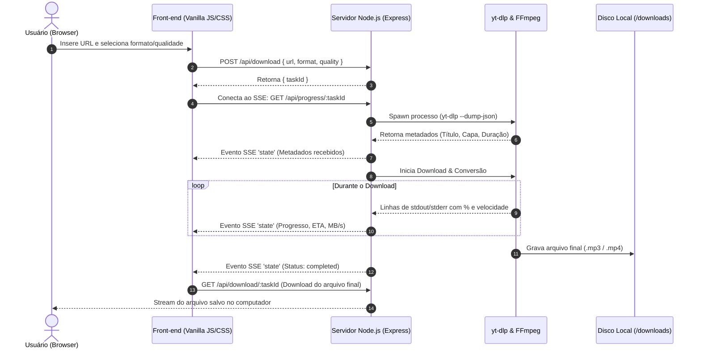

<div align="center">

# ⚡ OmniFetch v2.0
### Utilitário Moderno de Extração e Conversão de Mídias em MP3 e MP4

<p align="center">
  <a href="README.md">🇧🇷 Português</a> •
  <a href="README.en.md">🇺🇸 English</a> •
  <a href="README.es.md">🇪🇸 Español</a>
</p>

[](https://nodejs.org/)
[](https://expressjs.com/)
[](https://github.com/yt-dlp/yt-dlp)
[](https://ffmpeg.org/)
[](LICENSE)

<br/>


<p align="center">
  <b>Baixe e converta vídeos e áudios de YouTube, TikTok (sem marca d'água) e Instagram com velocidade máxima, interface ultra-fluida e métricas em tempo real.</b>
</p>

</div>

---

## 📑 Sumário

- [Visão Geral](#-visão-geral)
- [Principais Funcionalidades](#-principais-funcionalidades)
- [Plataformas Suportadas](#-plataformas-suportadas)
- [Tabela de Formatos & Qualidade](#-tabela-de-formatos--qualidade)
- [Arquitetura & Fluxo de Funcionamento](#-arquitetura--fluxo-de-funcionamento)
- [Tecnologias Utilizadas (Tech Stack)](#-tecnologias-utilizadas-tech-stack)
- [Pré-requisitos](#-pré-requisitos)
- [Instalação e Execução](#-instalação-e-execução)
- [Referência da API Local](#-referência-da-api-local)
- [Design System & Interface](#-design-system--interface)
- [Solução de Problemas (FAQ)](#-solução-de-problemas-faq)
- [Aviso Legal (Disclaimer)](#-aviso-legal-disclaimer)
- [Licença](#-licença)

---

## 🌟 Visão Geral

O **OmniFetch** é uma aplicação completa e local voltada para quem precisa baixar ou converter conteúdos multimídia da web sem depender de sites de terceiros cheios de anúncios invasivos, limites artificiais de velocidade ou riscos de privacidade.

Executando localmente no seu computador através do **Node.js**, o OmniFetch utiliza os binários de alta performance do **yt-dlp** e **FFmpeg**, transmitindo cada etapa do download via **Server-Sent Events (SSE)** diretamente para uma interface moderna, escura e responsiva com efeitos visuais *Dark Obsidian* e *Glassmorphism*.

---

## 🚀 Principais Funcionalidades

- ⚡ **Alta Velocidade Local:** Processamento direto no hardware da máquina, sem intermediários remotos ou filas de espera.
- 🎵 **Conversão Inteligente para MP3:** Extração limpa de faixas sonoras com taxas de bits configuráveis (até 320 kbps).
- 🎬 **Download de Vídeo em MP4:** Suporte a resoluções de até 1080p Full HD com multiplexação de áudio e vídeo automática via FFmpeg.
- 💧 **TikTok Sem Marca d'Água:** Remoção automática e preferencial de logotipos e marcas d'água em vídeos do TikTok.
- 📡 **Métricas em Tempo Real via SSE:** Acompanhe velocidade de transferência (MB/s), tempo estimado (ETA), percentual exato e tamanho do arquivo.
- 📋 **Agilidade com 1 Clique:** Botão nativo integrado à *Clipboard API* para colar URLs instantaneamente e detecção automática da plataforma.
- 🕒 **Histórico Local de Downloads:** Seus arquivos recentes ficam salvos no `localStorage` do navegador para download imediato.
- 🧹 **Rotina de Auto-Limpeza:** O servidor apaga automaticamente arquivos temporários e downloads com mais de 1 hora para economizar espaço em disco.
- 🔄 **Auto-Instalação e Auto-Update:** O servidor baixa automaticamente o executável do `yt-dlp` na primeira execução caso ele não esteja presente e verifica atualizações em segundo plano.

---

## 🌐 Plataformas Suportadas

| Plataforma | Suporte | Notas Técnicas |
| :--- | :---: | :--- |
| **YouTube** | ✅ Total | Vídeos convencionais, Shorts e extração de áudio. Suporte a metadados e capas originais. |
| **TikTok** | ✅ Total | Extração em alta definição **sem marca d'água** (*watermark-free streams*). |
| **Instagram** | ✅ Total | Reels, Posts públicos e vídeos de carrossel. *(Atenção: Perfis privados não são suportados sem autenticação).* |
| **Web Geral** | ✅ Amplo | Compatível com centenas de sites suportados nativamente pelo motor de extração do yt-dlp. |

---

## 🎚️ Tabela de Formatos & Qualidade

### 🎵 Áudio (MP3)
| Perfil | Taxa de Bits (Bitrate) | Ideal Para |
| :--- | :---: | :--- |
| **Alta Qualidade** | **320 kbps** | Coleções musicais, audiófilos e máxima fidelidade sonora. |
| **Média Qualidade** | **192 kbps** | Podcasts, entrevistas e equilíbrio entre espaço e som. |
| **Econômica** | **128 kbps** | Mensagens de voz longas, palestras e menor consumo de disco. |

### 🎬 Vídeo (MP4)
| Perfil | Resolução Alvo | Processamento |
| :--- | :---: | :--- |
| **Alta Qualidade** | **1080p (Full HD)** | Melhor fluxo de vídeo disponível + áudio de alta fidelidade multiplexado via FFmpeg. |
| **Média Qualidade** | **720p (HD)** | Excelente equilíbrio entre tamanho final e clareza visual. |
| **Econômica** | **480p (SD)** | Downloads ultrarrápidos e arquivos compactos. |

---

## 🏗️ Arquitetura & Fluxo de Funcionamento

O projeto foi projetado com arquitetura desacoplada e orientada a eventos unidirecionais:



---

## 💻 Tecnologias Utilizadas (Tech Stack)

### Back-end
- **[Node.js](https://nodejs.org/):** Ambiente de execução assíncrono em JavaScript.
- **[Express 5](https://expressjs.com/):** Framework web minimalista para rotas REST, despacho de arquivos e SSE.
- **[Server-Sent Events (SSE)](https://developer.mozilla.org/en-US/docs/Web/API/Server-sent_events):** Transmissão de métricas e status em tempo real sem complexidade de WebSockets.
- **[yt-dlp](https://github.com/yt-dlp/yt-dlp):** O mais avançado e ativo motor de extração de vídeo do mundo.
- **[@ffmpeg-installer/ffmpeg](https://www.npmjs.com/package/@ffmpeg-installer/ffmpeg):** Binário estático integrado para conversão, multiplexação e manipulação de codecs de mídia.

### Front-end
- **Vanilla Web (HTML5, Modern CSS, ES6+ JS):** Zero dependência de frameworks volumosos (sem React, Vue ou Angular), carregamento imediato e pegada de memória mínima.
- **Design System Dark Obsidian:** Interface inspirada no cosmos com degradês ultravioleta e efeitos de respiração de flares (*Breathing Star Flares*).
- **[Lucide Icons](https://lucide.dev/):** Conjunto leve e consistente de ícones vetoriais.
- **Fontes do Sistema:** *Inter* para navegação e ergonomia, e *JetBrains Mono* para métricas técnicas.

---

## 📋 Pré-requisitos

Para rodar o OmniFetch na sua máquina, você só precisa de:
- **[Node.js](https://nodejs.org/)** versão `18.0.0` ou superior.
- **NPM** (geralmente instalado junto ao Node.js).
- Conexão ativa com a internet (para baixar os vídeos e atualizar o yt-dlp).

> [!NOTE]
> Você **não precisa** instalar o FFmpeg ou o yt-dlp manualmente no sistema operacional. O pacote do FFmpeg já vem incluído nas dependências e o servidor faz o download e atualização do executável do yt-dlp automaticamente na inicialização.

---

## 🛠️ Instalação e Execução

### 1. Clonar ou Baixar o Repositório
```bash
git clone https://github.com/Nann-spec/omni-fetch.git
cd omni-fetch
```

### 2. Instalar as Dependências
```bash
npm install
```

### 3. Iniciar a Aplicação
```bash
npm start
```
*ou modo de desenvolvimento:*
```bash
npm run dev
```

> [!TIP]
> Assim que o servidor for iniciado na porta `3000`, seu navegador padrão será **aberto automaticamente** no endereço `http://localhost:3000`.

---

## 🔌 Referência da API Local

Se você deseja integrar o OmniFetch a outros scripts ou automações locais, utilize os endpoints REST disponíveis:

### 1. Solicitar Download
- **Método:** `POST`
- **Rota:** `/api/download`
- **Headers:** `Content-Type: application/json`
- **Body:**
  ```json
  {
    "url": "https://www.youtube.com/watch?v=dQw4w9WgXcQ",
    "format": "mp3",     // "mp3" ou "mp4"
    "quality": "high"    // "high", "medium" ou "low"
  }
  ```
- **Resposta (200 OK):**
  ```json
  {
    "taskId": "3fa85f64-5717-4562-b3fc-2c963f66afa6"
  }
  ```

### 2. Streaming de Progresso (SSE)
- **Método:** `GET`
- **Rota:** `/api/progress/:taskId`
- **Tipo de Resposta:** `text/event-stream`
- **Eventos Recebidos:** `event: state`
  ```json
  {
    "status": "downloading",
    "progress": 64.5,
    "speed": "8.42MiB/s",
    "eta": "00:12",
    "title": "Rick Astley - Never Gonna Give You Up (Official Music Video)",
    "thumbnail": "https://i.ytimg.com/vi/dQw4w9WgXcQ/maxresdefault.jpg",
    "duration": "3:33",
    "platform": "Youtube",
    "fileName": "Rick Astley - Never Gonna Give You Up.mp3",
    "error": ""
  }
  ```

### 3. Baixar Arquivo Concluído
- **Método:** `GET`
- **Rotas:**
  - `/api/download/:taskId`
  - `/api/files/:taskId`
- **Retorno:** Fluxo de dados binários do arquivo (`Content-Disposition: attachment`).

### 4. Atualizar Motor yt-dlp
- **Método:** `POST`
- **Rota:** `/api/update`
- **Resposta:**
  ```json
  {
    "success": true,
    "message": "yt-dlp verificado/atualizado com sucesso!"
  }
  ```

---

## 🎨 Design System & Interface

Para entender todas as variáveis CSS, paletas hexadecimais, métricas de layout e padrões de componentes (Modais, Toasts, Cards de Progresso), consulte o arquivo dedicado de diretrizes de design:
👉 **[DESIGN.md](file:///C:/Users/nanan/Documents/GeminiCLI/youtube-to-mp3-or-mp4/DESIGN.md)**

---

## ❓ Solução de Problemas (FAQ)

### O download do Instagram falhou, o que aconteceu?
O Instagram frequentemente bloqueia contas e posts privados. O OmniFetch acessa diretamente conteúdos públicos. Se uma publicação exigir login ou pertencer a um perfil privado, o servidor retornará um aviso explicativo.

### O download parou ou está com velocidade instável?
As plataformas de vídeo atualizam seus algoritmos constantemente para conter ferramentas de download. Caso sinta instabilidade, o OmniFetch tenta atualizar o motor automaticamente ao reiniciar ou via endpoint `/api/update`.

### Onde ficam salvos os arquivos temporários?
Ficam armazenados na pasta local `downloads/<taskId>/`. Uma rotina interna roda a cada 15 minutos e limpa qualquer pasta criada há mais de 1 hora, liberando seu disco automaticamente.

---

## ⚖️ Aviso Legal (Disclaimer)

> [!IMPORTANT]
> **Finalidade Educacional e Uso Pessoal:**
> Este software foi desenvolvido exclusivamente para fins de estudo, pesquisa e uso estritamente pessoal.
> 
> * **Propriedade Intelectual & Direitos Autorais:** O usuário final é o único e exclusivo responsável pela utilização desta ferramenta e pelo cumprimento das leis de propriedade intelectual de seu país, assim como dos Termos de Serviço de cada plataforma acessada (YouTube, TikTok, Instagram, etc.). **Não utilize este software para baixar, armazenar ou distribuir conteúdos protegidos por direitos autorais sem autorização formal do respectivo titular.**
> * **Propriedade das Marcas:** Todas as marcas registradas, nomes de serviços e logotipos de terceiros mencionados neste projeto pertencem aos seus respectivos proprietários e são utilizados apenas de forma descritiva para fins de compatibilidade e interoperabilidade técnica.
> * **Isenção de Responsabilidade:** Os desenvolvedores deste projeto não incentivam a pirataria e não se responsabilizam civil ou criminalmente por qualquer uso indevido, ilícito ou em desacordo com as diretrizes das plataformas de terceiros.

---

## 📄 Licença

Este projeto está distribuído sob a licença **ISC**. Consulte o arquivo [package.json](file:///C:/Users/nanan/Documents/GeminiCLI/youtube-to-mp3-or-mp4/package.json) para mais detalhes.

<div align="center">
  <sub>Construído com carinho para produtividade e liberdade no consumo de mídias digitais.</sub>
</div>
